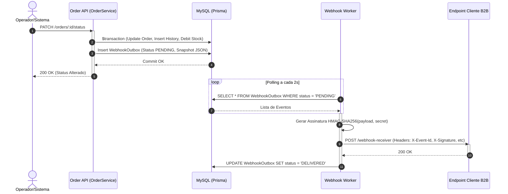

### FDD: Sistema de Webhooks de Notificação de Pedidos

Versão: 1.0.0  
Data: 2026-10-05  
Responsável: Bruno (Engenheiro Pleno) & Diego (Engenheiro Sênior)  

---

### 1. Contexto e motivação técnica

O Order Management System (OMS) atual gerencia o ciclo de vida de pedidos, porém não dispõe de nenhum mecanismo de notificação ativa para sistemas externos. Parceiros B2B (ex: Atlas Comercial, MaxDistribuição e Nova Cargo) dependem de requisições de *polling* contínuas no endpoint `GET /orders` para identificar alterações de status de seus pedidos.

Essa abordagem impõe sobrecarga desnecessária na infraestrutura, gera latência na atualização dos sistemas parceiros e cria o risco de perda de clientes estratégicos. 

A solução técnica consiste na criação de um módulo de **Outbound Webhooks** baseado no padrão **Transactional Outbox**. O evento de mudança de status é gravado no banco MySQL na mesma transação atômica que altera a ordem em [`src/modules/orders/order.service.ts`](file:///home/s052167316/fullcycle/mba-ia-desafio-design-docs-com-ia/src/modules/orders/order.service.ts). Um worker assíncrono em processo separado (`src/worker.ts`) lê periodicamente essa outbox via polling (2s), assina o payload via HMAC-SHA256 e efetua a entrega ao endpoint HTTPS do cliente com garantia *at-least-once*, controle de retentativas com *backoff* exponencial e suporte a Dead Letter Queue (DLQ).

---

### 2. Objetivos técnicos

- **Latência de Notificação:** Garantir latência de entrega inferior a 10 segundos a partir da transição de status do pedido no OMS.
- **Consistência Atômica:** Garantir 100% de consistência entre a mudança de status do pedido e a geração do evento no outbox (zero eventos órfãos ou perdas se a transação do pedido commitar).
- **Garantia de Entrega:** Garantir entrega com semântica *at-least-once* e desduplicação por `X-Event-Id` no receptor.
- **Resiliência a Falhas de Parceiros:** Suportar indisponibilidades de parceiros por até 15 horas através de 5 retentativas com backoff exponencial antes do descarte para DLQ.
- **Segurança e Integridade:** Assegurar autenticidade e não-adulteração do payload via HMAC-SHA256 com suporte a rotação de chaves sem indisponibilidade (*grace period* de 24 horas).

---

### 3. Escopo e exclusões

**Incluído**
- Modelagem de tabelas de banco de dados no Prisma (`WebhookEndpoint`, `WebhookOutbox`, `WebhookDeadLetter`).
- Gravação atômica do evento na outbox dentro do método `changeStatus()` do `OrderService`.
- Worker Node.js assíncrono (`src/worker.ts`) rodando em polling de 2 segundos.
- Engine de disparo HTTP POST com HMAC-SHA256, timeout de 10s e limite de payload de 64KB.
- Política de retry com 5 tentativas (1m, 5m, 30m, 2h, 12h) e direcionamento automático para DLQ.
- Endpoints CRUD para cadastro e gestão de webhooks pelo cliente.
- Endpoint administrativo `POST /admin/webhooks/dead-letter/:id/replay` restrito a role `ADMIN`.
- Endpoint de consulta de histórico de entregas (`GET /webhooks/:id/deliveries`).

**Excluído**
- Envio de notificações por e-mail quando endpoints falharem consecutivamente.
- Rate limiting de saída de mensagens por cliente (a ser observado em produção).
- Painel/Dashboard visual no frontend (exclusivo para consumo via API backend).
- Suporte a múltiplos workers em paralelo com ordenação global garantida (limitado a single-worker).

---

### 4. Fluxos detalhados e diagramas

**Fluxo principal (Geração e Envio de Webhook com Sucesso)**
1. Operador/Sistema altera o status do pedido via API (`PATCH /orders/:id/status`).
2. `OrderService.changeStatus()` inicia transação no Prisma (`tx`).
3. O pedido é atualizado, a `order_status_history` é gravada e o estoque ajustado.
4. Dentro da mesma `tx`, a função `publishWebhookEvent()` consulta os `WebhookEndpoint` ativos do cliente interessados naquele status.
5. Para cada webhook correspondente, é inserido um registro na tabela `WebhookOutbox` com status `PENDING` e snapshot do payload JSON.
6. A transação SQL é commitada com sucesso.
7. O worker (`src/worker.ts`) no ciclo de 2s lê o evento `PENDING`.
8. O worker calcula a assinatura HMAC-SHA256 utilizando a secret ativa do webhook.
9. O worker envia requisição HTTP POST para a URL configurada com os cabeçalhos `X-Event-Id`, `X-Webhook-Id`, `X-Signature`, `X-Timestamp`.
10. O cliente responde com HTTP `200 OK` dentro de 10 segundos.
11. O worker atualiza o status do evento na `WebhookOutbox` para `DELIVERED`, preenchendo o tempo de resposta e código HTTP.

**Fluxos alternativos e exceções**
- **Falha de Rede ou Resposta != 2xx (Retry Flow):** Se o envio falhar ou estourar o timeout de 10s, o worker incrementa `attempts`, altera o status para `RETRY_PENDING` e calcula o `nextRetryAt` com base no backoff exponencial (1m, 5m, 30m, 2h, 12h).
- **Exaustão de Tentativas (DLQ Flow):** Após a 5ª tentativa falhar, o worker remove ou marca o evento na outbox e cria um registro na tabela `WebhookDeadLetter` com o motivo detalhado e snapshot do payload.
- **Replay Manual via Admin:** O administrador aciona `POST /admin/webhooks/dead-letter/:id/replay`. O sistema valida a permissão `ADMIN`, remove o item da DLQ e reinserção na `WebhookOutbox` com status `PENDING` e `attempts = 0`.
- **Rotação de Secret com Grace Period:** O cliente solicita `POST /webhooks/:id/rotate-secret`. A secret atual passa para `previousSecret` com expiração para 24h à frente (`secretExpiresAt`), e uma nova `secret` é gerada. Durante as 24h, o worker aceita/assina usando a nova secret, mas o cliente pode validar contra ambas.

**Diagramas**



---

### 5. Contratos públicos (assinaturas, endpoints, headers, exemplos)

**[Contrato 1] Cadastrar Endpoint de Webhook**
- Tipo: `endpoint`
- Assinatura/Rota: `POST /webhooks`
- Método: `POST`
- Semântica de status/headers:
  - `201 Created`: Webhook cadastrado com sucesso. A secret é retornada apenas nesta resposta.
  - `400 Bad Request`: Payload inválido ou URL não utiliza HTTPS.
  - `401 Unauthorized`: Token JWT ausente ou inválido.

**Exemplo de requisição**
```json
{
  "customerId": "c39a82b1-6a2d-4b95-a86d-1b329402a111",
  "url": "https://api.atlascomercial.com.br/v1/webhooks/orders",
  "events": ["PAID", "PROCESSING", "SHIPPED", "DELIVERED", "CANCELLED"]
}
```

**Exemplo de resposta**
```json
{
  "id": "wh_8f91a2b3-4c5d-6e7f-8a9b-0c1d2e3f4a5b",
  "customerId": "c39a82b1-6a2d-4b95-a86d-1b329402a111",
  "url": "https://api.atlascomercial.com.br/v1/webhooks/orders",
  "secret": "whsec_9a8b7c6d5e4f3a2b1c0d9e8f7a6b5c4d3e2f1a0b9c8d7e6f5a4b3c2d1e0f9a8b",
  "events": ["PAID", "PROCESSING", "SHIPPED", "DELIVERED", "CANCELLED"],
  "active": true,
  "createdAt": "2026-10-05T10:00:00.000Z"
}
```

---

**[Contrato 2] Listar Webhooks de um Cliente**
- Tipo: `endpoint`
- Assinatura/Rota: `GET /webhooks?customerId=c39a82b1-6a2d-4b95-a86d-1b329402a111`
- Método: `GET`
- Semântica de status/headers:
  - `200 OK`: Lista de webhooks retornada com sucesso (campo `secret` é omisso por segurança).
  - `401 Unauthorized`: Autenticação necessária.

**Exemplo de resposta**
```json
{
  "data": [
    {
      "id": "wh_8f91a2b3-4c5d-6e7f-8a9b-0c1d2e3f4a5b",
      "customerId": "c39a82b1-6a2d-4b95-a86d-1b329402a111",
      "url": "https://api.atlascomercial.com.br/v1/webhooks/orders",
      "events": ["PAID", "SHIPPED"],
      "active": true,
      "createdAt": "2026-10-05T10:00:00.000Z"
    }
  ]
}
```

---

**[Contrato 3] Consultar Histórico de Entregas de um Webhook**
- Tipo: `endpoint`
- Assinatura/Rota: `GET /webhooks/:id/deliveries?page=1&pageSize=20`
- Método: `GET`
- Semântica de status/headers:
  - `200 OK`: Histórico paginado de tentativas de envio executadas pelo worker.
  - `404 Not Found`: Webhook não encontrado (`WEBHOOK_NOT_FOUND`).

**Exemplo de resposta**
```json
{
  "data": [
    {
      "id": "del_11223344-5566-7788-9900-aabbccddeeff",
      "webhookId": "wh_8f91a2b3-4c5d-6e7f-8a9b-0c1d2e3f4a5b",
      "eventId": "evt_99887766-5544-3322-1100-ffaaddeeccbbaa",
      "eventType": "order.status_changed",
      "statusCode": 200,
      "responseTimeMs": 142,
      "status": "DELIVERED",
      "attempts": 1,
      "deliveredAt": "2026-10-05T10:05:02.142Z"
    }
  ],
  "meta": {
    "page": 1,
    "pageSize": 20,
    "total": 1
  }
}
```

---

**[Contrato 4] Reprocessar Evento da Dead Letter Queue (DLQ)**
- Tipo: `endpoint`
- Assinatura/Rota: `POST /admin/webhooks/dead-letter/:id/replay`
- Método: `POST`
- Semântica de status/headers:
  - `200 OK`: Evento retirado da DLQ e reinserido na outbox com sucesso.
  - `403 Forbidden`: Usuário autenticado não possui papel `ADMIN`.
  - `404 Not Found`: Registro de DLQ não encontrado.

**Exemplo de requisição**
```json
{}
```

**Exemplo de resposta**
```json
{
  "message": "Webhook event successfully re-queued for delivery",
  "deadLetterId": "dlq_55443322-1100-aaaa-bbbb-ccccddddeeee",
  "newOutboxId": "out_99001122-3344-5566-7788-99aabbccddeef"
}
```

---

**[Contrato 5] Headers HTTP de Envio do Webhook (Payload Outbound)**
- Tipo: `headers`
- Assinatura/Rota: Envio disparado pelo Worker via `HTTP POST` para o destino do cliente
- Headers de Envio:
  - `Content-Type`: `application/json`
  - `X-Event-Id`: `evt_99887766-5544-3322-1100-ffaaddeeccbbaa` (UUID para deduplicação)
  - `X-Webhook-Id`: `wh_8f91a2b3-4c5d-6e7f-8a9b-0c1d2e3f4a5b`
  - `X-Signature`: `sha256=a591a6d40bf420404a011733cfb7b190d62c65bf0bcda32b57b277d9ad9f146e`
  - `X-Timestamp`: `2026-10-05T10:05:02.000Z`

**Exemplo do Corpo do Payload Enviado pelo Worker**
```json
{
  "eventId": "evt_99887766-5544-3322-1100-ffaaddeeccbbaa",
  "eventType": "order.status_changed",
  "timestamp": "2026-10-05T10:05:02.000Z",
  "customerId": "c39a82b1-6a2d-4b95-a86d-1b329402a111",
  "data": {
    "orderId": "ord_77665544-3322-1100-aabb-ccddeeff0011",
    "orderNumber": "ORD-000142",
    "fromStatus": "PAID",
    "toStatus": "SHIPPED",
    "totalCents": 15400
  }
}
```

---

### 6. Erros, exceções e fallback

**Matriz de erros previstos e tratamentos**

| Código de Erro | Status HTTP | Mensagem Padrão | Descrição / Causa |
| --- | --- | --- | --- |
| `WEBHOOK_NOT_FOUND` | 404 | Webhook endpoint not found | ID de webhook informado não existe no banco de dados. |
| `WEBHOOK_INVALID_URL` | 400 | Invalid webhook URL (HTTPS required) | URL cadastrada é inválida ou não utiliza protocolo seguro `https://`. |
| `WEBHOOK_SECRET_REQUIRED` | 400 | Secret is required for manual setup | Tentativa de cadastro sem fornecimento de parâmetro obrigatório. |
| `WEBHOOK_INACTIVE` | 422 | Webhook endpoint is inactive | Tentativa de operação em um webhook desativado. |
| `WEBHOOK_PAYLOAD_TOO_LARGE` | 422 | Event payload exceeds 64KB limit | O snapshot do evento gerado ultrapassou o teto de 64KB. |
| `WEBHOOK_DELIVERY_FAILED` | 502 | Target endpoint returned HTTP error | Endpoint de destino respondeu com status 4xx ou 5xx. |
| `WEBHOOK_REPLAY_FAILED` | 409 | Event cannot be replayed from DLQ | Falha de conflito ao tentar reprocessar evento inexistente ou duplicado na DLQ. |

**Estratégias de resiliência**
- **Timeouts:** Timeout limite de **10 segundos** por chamada HTTP efetuada pelo worker.
- **Retries com Backoff Exponencial:** 5 retentativas agendadas nos intervalos de 1min, 5min, 30min, 2h e 12h.
- **Circuit Breaker / Isolation:** Erros em um cliente B2B não afetam a entrega dos eventos de outros clientes no worker.
- **DLQ Fallback:** Após 5 falhas, a notificação sai da outbox ativa e é armazenada na `WebhookDeadLetter`.

**Invariantes Críticos**
- NENHUM status de pedido pode mudar no banco sem que o evento correspondente seja inserido na `WebhookOutbox` (quando houver webhook ativo).
- NENHUMA requisição de webhook será enviada sem o cabeçalho `X-Signature` HMAC-SHA256.
- A rotação de secret NUNCA deve invalidar a secret anterior imediatamente (respeito estrito ao grace period de 24h).

---

### 7. Observabilidade

**Métricas**
- `webhook_events_published_total`: Contador de eventos gravados na outbox (por status).
- `webhook_deliveries_total`: Contador de disparos efetuados (rotulados por status HTTP e cliente).
- `webhook_delivery_latency_seconds`: Histograma do tempo entre a criação do evento no outbox e a entrega com sucesso (`200 OK`).
- `webhook_dead_letter_total`: Contador de eventos movidos para a DLQ.

**Logs**
- Formato JSON estruturado via Pino Logger em [`src/shared/logger/index.ts`](file:///home/s052167316/fullcycle/mba-ia-desafio-design-docs-com-ia/src/shared/logger/index.ts).
- Campos essenciais em cada disparo: `eventId`, `webhookId`, `customerId`, `orderId`, `attempt`, `statusCode`, `responseTimeMs`, `url`.

**Tracing**
- Propagação da chave `eventId` em todos os registros de log correlacionados desde a chamada do `changeStatus` até o disparo no worker.

**Dashboards e alertas**
- Alerta configurado para quando a taxa de erros da DLQ (`webhook_dead_letter_total`) ultrapassar 5% das entregas em uma janela de 15 minutos.

---

### 8. Dependências e compatibilidade

| Componente | Versão mínima | Observações |
| --- | --- | --- |
| Node.js | >= 18.0.0 | Runtime de execução do server e do worker. |
| MySQL | >= 8.0 | Suporte a transações ACID e campos JSON. |
| Prisma ORM | ^5.0.0 | Mapeamento relacional e transações em `$transaction`. |
| Zod | ^3.22.0 | Validação de schemas HTTP. |
| Pino | ^8.0.0 | Logger estruturado. |

**Garantias de compatibilidade**
- Paridade total com o padrão de módulos do projeto em `src/modules/`.
- Compatibilidade retroativa garantida na rotação de secrets através da convivência de 24 horas da chave anterior.

---

### 9. Integração com o sistema existente

Esta seção descreve como o módulo de webhooks se conecta com a arquitetura do projeto atual:

1. **[`src/modules/orders/order.service.ts`](file:///home/s052167316/fullcycle/mba-ia-desafio-design-docs-com-ia/src/modules/orders/order.service.ts):**
   * O método `changeStatus()` será estendido para invocar a função `publishWebhookEvent(tx, order, fromStatus, toStatus)` passando a instância `tx` da transação do Prisma. Isso garante que a inserção na `WebhookOutbox` seja atômica com o update de `Order`, inserção de `OrderStatusHistory` e decremento de estoque.
2. **[`prisma/schema.prisma`](file:///home/s052167316/fullcycle/mba-ia-desafio-design-docs-com-ia/prisma/schema.prisma):**
   * Adição dos modelos `WebhookEndpoint`, `WebhookOutbox` e `WebhookDeadLetter`, criando a relação com o model `Customer` existente via `customerId`.
3. **[`src/shared/errors/http-errors.ts`](file:///home/s052167316/fullcycle/mba-ia-desafio-design-docs-com-ia/src/shared/errors/http-errors.ts) & [`src/shared/errors/app-error.ts`](file:///home/s052167316/fullcycle/mba-ia-desafio-design-docs-com-ia/src/shared/errors/app-error.ts):**
   * Reutilização da classe base `AppError` e criação das exceções específicas com prefixos `WEBHOOK_*` tratadas automaticamente pelo middleware centralizado de erros em [`src/middlewares/error.middleware.ts`](file:///home/s052167316/fullcycle/mba-ia-desafio-design-docs-com-ia/src/middlewares/error.middleware.ts).
4. **[`src/middlewares/auth.middleware.ts`](file:///home/s052167316/fullcycle/mba-ia-desafio-design-docs-com-ia/src/middlewares/auth.middleware.ts):**
   * As rotas de CRUD de webhooks em `src/modules/webhooks/webhook.routes.ts` utilizarão o middleware `requireAuth` existente. A rota de replay da DLQ usará o `requireRole(UserRole.ADMIN)`.

---

### 10. Critérios de aceite técnicos

- Todos os contratos HTTP expostos retornarem payloads e status codes exatamente como definidos no FDD.
- A alteração de status de um pedido no `OrderService` gerar um registro na `WebhookOutbox` dentro da mesma transação SQL.
- O worker (`src/worker.ts`) conseguir processar eventos pendentes em tempo inferior a 10 segundos após a alteração no banco.
- Tentativas de cadastro com URLs utilizando protocolo `http://` serem rejeitadas com erro 400 (`WEBHOOK_INVALID_URL`).
- Eventos com 5 falhas consecutivas serem transferidos para a tabela `WebhookDeadLetter`.
- O endpoint `POST /admin/webhooks/dead-letter/:id/replay` aceitar requisições apenas de usuários com `UserRole.ADMIN`.

---

### 11. Riscos e mitigação

### Risco 1: Acúmulo descontrolado de linhas na tabela `WebhookOutbox`
- **Probabilidade:** Alta
- **Impacto:** Degradação de performance nas queries de polling do worker e aumento do tamanho do banco MySQL.
- **Mitigação:**
  - Adição de índices compostos em `(status, nextRetryAt, createdAt)`.
  - Leitura em lotes limitados (*batching*) pelo worker.
- **Plano de contingência:** Implementação de script cron de expurgo para arquivar/excluir registros em estado `DELIVERED` há mais de 30 dias.

### Risco 2: Race Condition no processamento de ordenação de status do pedido
- **Probabilidade:** Média
- **Impacto:** O cliente receber a notificação `SHIPPED` antes da notificação `PAID`.
- **Mitigação:**
  - Execução de apenas 1 instância do worker (single-worker) no ambiente inicial.
  - Ordenação rigorosa por `createdAt ASC` na busca da outbox.
- **Plano de contingência:** Caso haja transição rápida, incluir o timestamp do evento no payload (`timestamp`) e orientar o cliente a checar a cronologia da mensagem.
